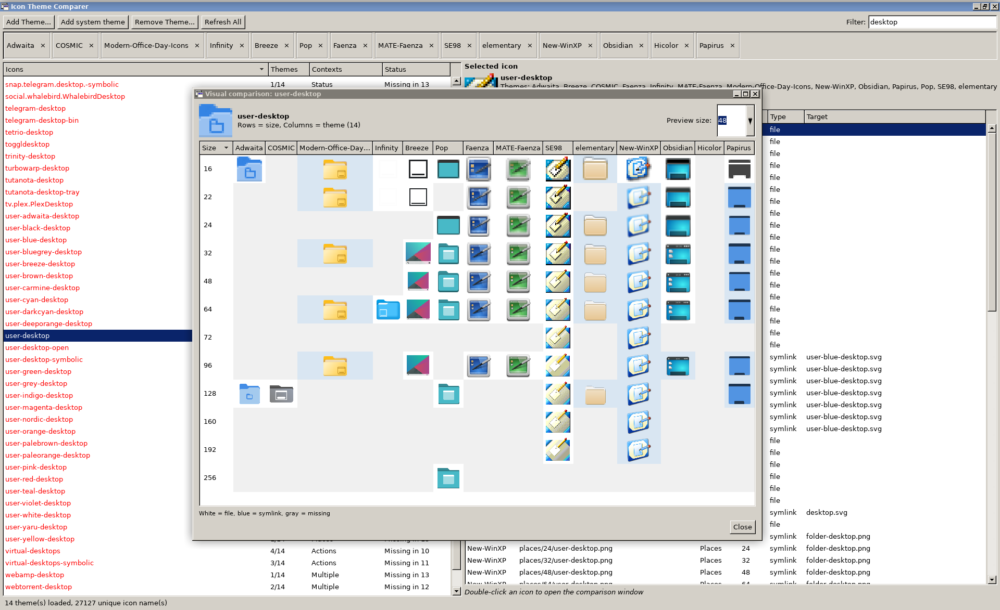
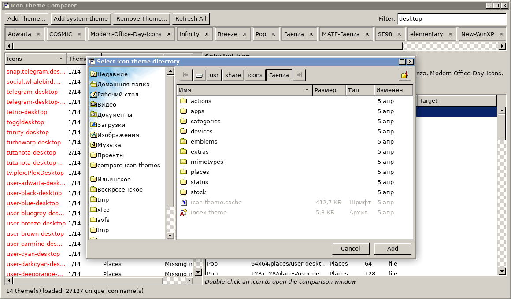
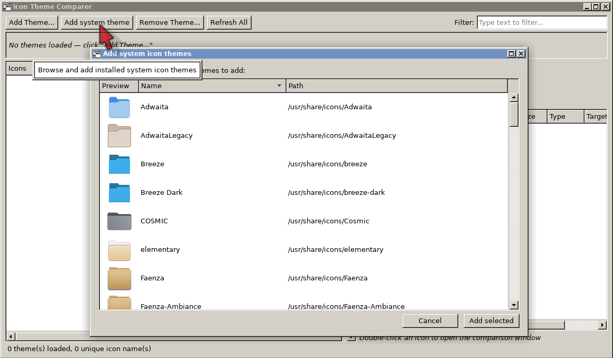
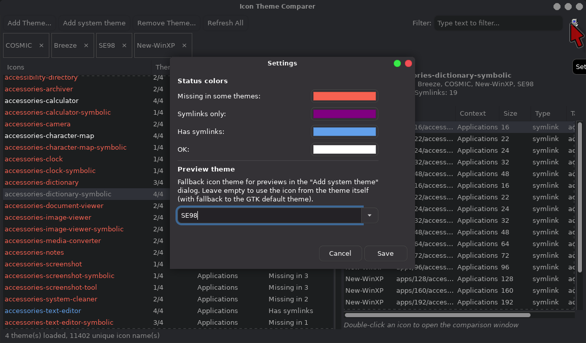

# Icon theme comparer

## A tool for comparing Linux icon themes.

Syntax:
```
gjs compare-icon-themes.js
```

Or:

```
cjs compare-icon-themes.js
```

*Screenshots:*

**Visual comparison**



**Browsing theme directories**



**System themes adding**



**Color settings dialog**

